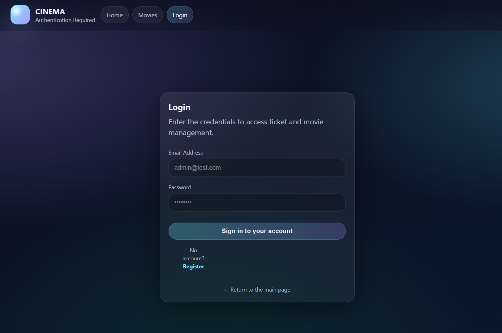
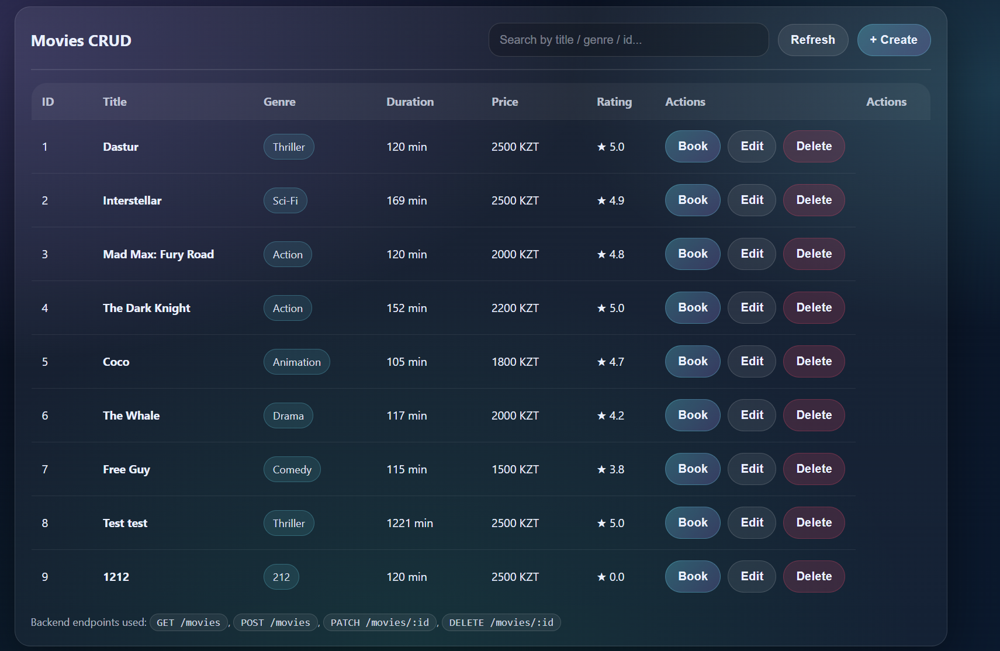
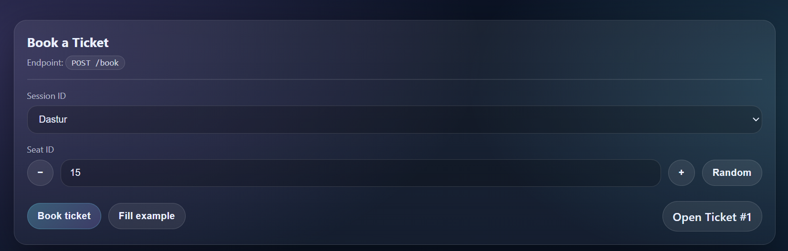
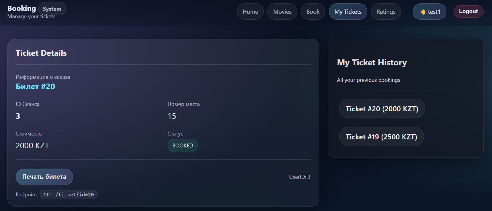
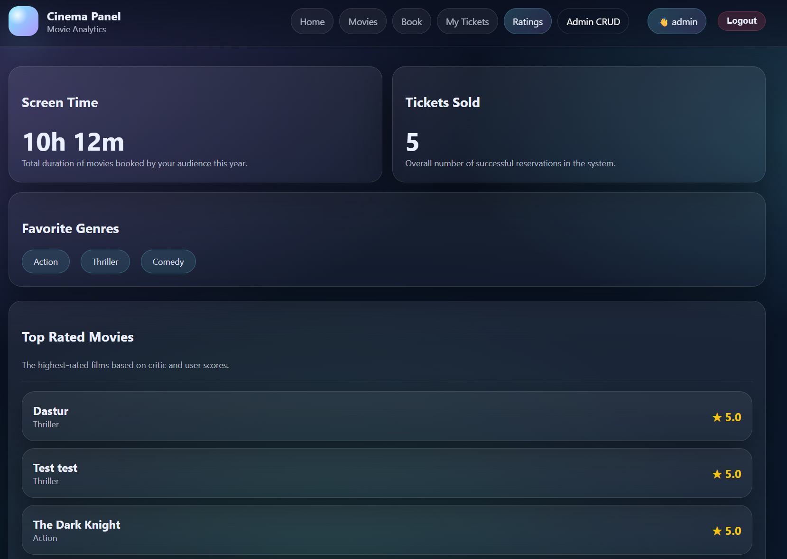

# OmniCinema - UI Mockups & User Scenarios

This document outlines the user interface mockups, user interaction scenarios, and API endpoints mapping for the **OmniCinema** online cinema booking web platform.

---

## Table of Contents

1. [System Overview](#system-overview)
2. [Scenario 1: User Authentication](#1-scenario-1-user-authentication)
3. [Scenario 2: Movies Management (Admin CRUD)](#2-scenario-2-movies-management-admin-crud)
4. [Scenario 3: Ticket Booking Process](#3-scenario-3-ticket-booking-process)
5. [Scenario 4: Ticket Details & History](#4-scenario-4-ticket-details--history)
6. [Scenario 5: Analytics & Dashboard](#5-scenario-5-analytics--dashboard)

---

## System Overview

The OmniCinema platform enables users to browse movies, reserve seats in real time, view booking receipts, and allows administrators to manage movie listings and view system analytics.

---

## 1. Scenario 1: User Authentication

### Description
Users and administrators log into the system to access personalized features such as booking tickets or administrative controls.

* **Actors:** Registered User, Administrator
* **Preconditions:** The user is on the login page and not authenticated.

### Action Flow
1. User navigates to the **Login** screen.
2. User enters valid credentials (**Email Address** and **Password**).
3. User clicks the **Sign in to your account** button.
4. System validates credentials and issues an authentication token (JWT).

### Mockup Reference

---

## 2. Scenario 2: Movies Management (Admin CRUD)

### Description
Administrators can view, search, create, edit, or delete movie entries from the cinema catalog.

* **Actors:** Administrator
* **Preconditions:** User is logged in with administrative privileges.

### Core Features
* **Catalog View:** Tabular display showing movie attributes: `ID`, `Title`, `Genre`, `Duration`, `Price`, and `Rating`.
* **Search / Filter:** Dynamic search field (`Search by title / genre / id...`).
* **Create:** `+ Create` button triggers a form modal/page to add a movie.
* **Update / Delete:** Actions column provides `Edit` and `Delete` operations per item.

### Mockup Reference

---

## 3. Scenario 3: Ticket Booking Process

### Description
Authenticated users select a movie session and book a specific seat.

* **Actors:** Authenticated User
* **Preconditions:** User is logged in and navigating the booking page.

### Action Flow
1. User navigates to the **Book** tab.
2. User selects the movie session from the **Session ID** dropdown (e.g., *Dastur*).
3. User specifies a seat via **Seat ID** controls (increment/decrement) or clicks **Random**.
4. User clicks **Book ticket** to confirm reservation.

### Mockup Reference

---

## 4. Scenario 4: Ticket Details & History

### Description
Users can review their active ticket details, print receipts, and browse past booking history.

* **Actors:** Authenticated User

### Details Displayed
* **Ticket Number:** Ticket #20
* **Session ID:** 3
* **Seat Number:** 15
* **Price:** 2000 KZT
* **Status Badge:** `BOOKED`
* **Print Action:** "Печать билета" (Print Ticket) button.
* **History Sidebar:** Lists recent reservations with total price (e.g., `Ticket #20 (2000 KZT)`).

### Mockup Reference

---

## 5. Scenario 5: Analytics & Dashboard

### Description
Administrators monitor overall cinema platform metrics including watch time, sales volume, top genres, and highest-rated movies.

* **Actors:** Administrator, Manager

### Key Metrics
* **Screen Time:** Total duration of movies booked by audience (e.g., `10h 12m`).
* **Tickets Sold:** Total volume of successful bookings (e.g., `5`).
* **Favorite Genres:** Tag-based visualization of popular genres (*Action*, *Thriller*, *Comedy*).
* **Top Rated Movies:** Ranked list of films based on rating scores.

### Mockup Reference
